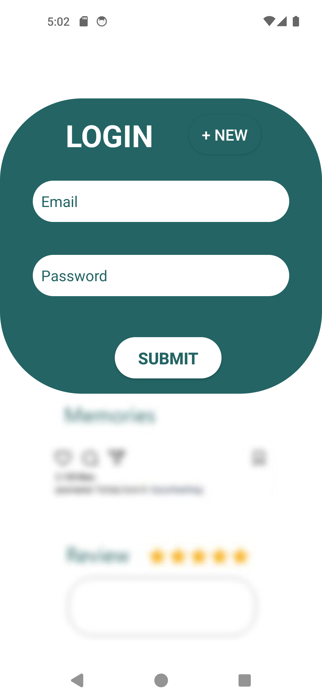
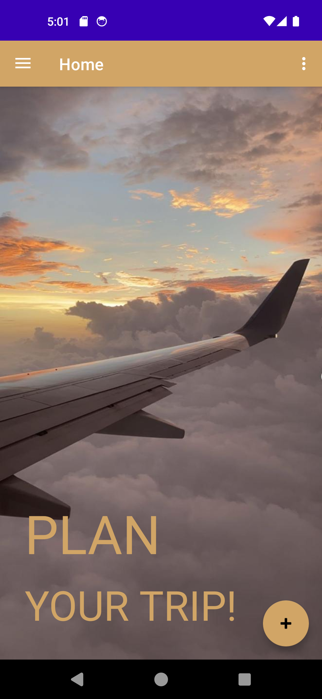
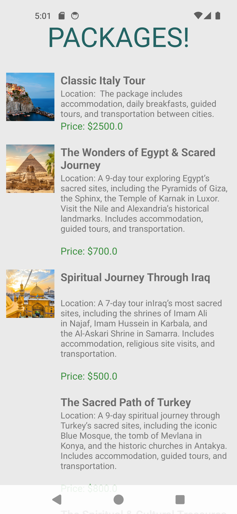

# Vicanza Trip Planner 🌍

**An Android Travel Planning Application**

Vicanza Trip Planner is our first university course project, developed as part of our academic journey in software development.

The application was designed to help users explore travel destinations, browse vacation packages, discover hotels, restaurants, and attractions, and organize their trips through a mobile interface.

This project gave us practical experience in Android development, backend integration, database management, and building a complete application that connects a mobile frontend to a server-side database.

## Features

- User registration and login
- Browse travel packages and destinations
- View package details and pricing
- Explore hotels, restaurants, and places
- Plan and save trips
- Navigate between application screens
- Logout functionality

## Application Screenshots

  
  
  

## Technologies Used

**Android Application**
- Java
- XML
- Android Studio

**Backend**
- PHP
- REST-style HTTP APIs
- JSON

**Database**
- MySQL / MariaDB
- XAMPP

## Project Structure

- `app/` — Android application source code and resources
- `backend/` — PHP backend and API endpoints
- `backend/db_config.php` — Database connection configuration
- `backend/schema.sql` — Database table structures without user records

## Getting Started

### 1. Android Setup

1. Clone the repository.
2. Open the project in Android Studio.
3. Allow Gradle to synchronize.
4. Start an Android emulator.
5. Build and run the application.

### 2. Database Setup

1. Install and start XAMPP.
2. Start Apache and MySQL/MariaDB.
3. Create a database named `mydatabase`.
4. Import `backend/schema.sql`.
5. Configure the database connection using the environment variables `DB_HOST`, `DB_PORT`, `DB_NAME`, `DB_USER`, and `DB_PASSWORD`.

The development configuration uses MariaDB on port `3307`. Adjust this according to your environment.

**Note:** The schema contains table definitions only. It does not include existing users, saved trips, or sample travel packages.

### 3. PHP Backend Setup

1. Copy the PHP files from `backend/` into your XAMPP web directory under `htdocs/android_api/`.
2. Configure the database connection.
3. Start Apache and MariaDB.
4. Ensure the Android application's API URLs point to your backend.

For the Android emulator, the development backend address is:

`http://10.0.2.2/android_api/`

The address `10.0.2.2` allows the Android emulator to communicate with the host computer's local server.

## Academic Background

Vicanza Trip Planner was the **first project we developed for a university course**.

It represents an early milestone in our software development journey, where we applied programming concepts learned at university to create a working Android application.

Through this project, we gained hands-on experience with user interfaces, backend development, database connectivity, and application functionality.

## Developers

- **Nour Mistrah**
- **Aya Alatrash**

Developed collaboratively as a university course project.

## Project Status

Academic project created for learning and demonstration purposes. The backend requires local setup and is not publicly hosted.